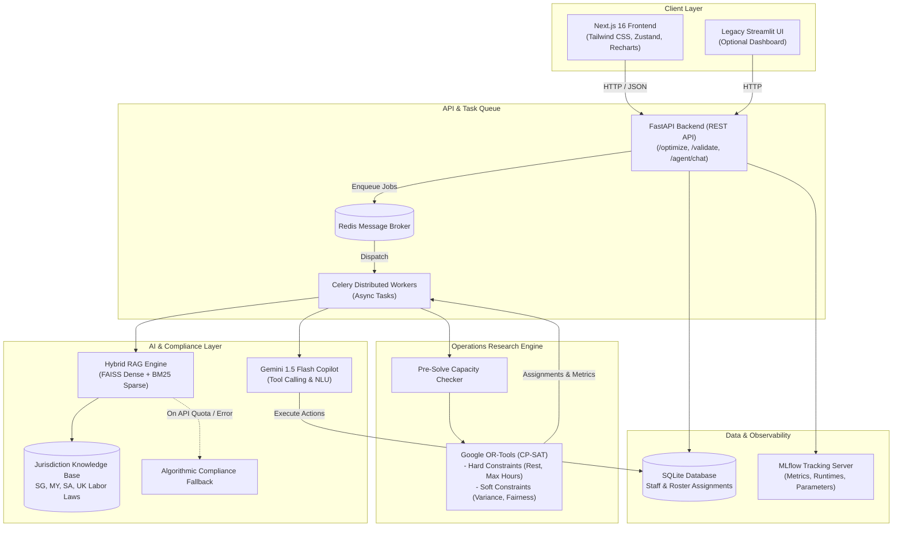

# ✈️ SATS AI Multi-Country Rostering Platform

[](https://fastapi.tiangolo.com)
[](https://nextjs.org)
[](https://developers.google.com/optimization)
[](https://ai.google.dev)
[](https://www.langchain.com)
[](https://docs.celeryq.dev)
[](https://www.docker.com)
[](https://mlflow.org)

An enterprise-grade, multi-country ground workforce scheduling platform designed for airport operations (SATS). The system combines **deterministic Operations Research (Google OR-Tools CP-SAT)** for mathematical constraint solving with **probabilistic Generative AI (Google Gemini + Hybrid RAG)** for conversational scheduling, dynamic demand forecasting, and strict statutory compliance auditing across international jurisdictions.

---

## 📑 Table of Contents

- [Overview & Architecture](#-overview--architecture)
- [Key Features](#-key-features)
- [System Architecture Diagram](#-system-architecture-diagram)
- [Multi-Country Labor Law Compliance](#-multi-country-labor-law-compliance)
- [Tech Stack](#-tech-stack)
- [Repository Structure](#-repository-structure)
- [Quick Start with Docker (Recommended)](#-quick-start-with-docker-recommended)
- [Manual Local Development](#-manual-local-development)
- [Environment Variables](#-environment-variables)
- [Core API Endpoints](#-core-api-endpoints)
- [Testing & Quality Assurance](#-testing--quality-assurance)
- [Academic & Capstone Context](#-academic--capstone-context)

---

## 🌐 Overview & Architecture

Airport ground operations (baggage handling, ramp agents, cargo logistics, passenger services) operate around the clock in high-volatility environments governed by flight schedules, weather disruptions, and strict jurisdiction-dependent labor laws.

Traditional rostering tools are either opaque "black-box" solvers or static spreadsheets. This project introduces a **Hybrid AI Architecture**:

1. **Deterministic Layer (Operations Research)**:
   - Uses **Google OR-Tools CP-SAT** to enforce strict hard constraints (shift coverage, rest intervals, maximum consecutive days, weekly hours ceilings) and optimize soft constraints (workload variance minimization and Gini fairness).
   - Features pre-solve capacity analysis to detect mathematical impossibilities before solver execution.

2. **Probabilistic Generative Layer (Gemini & RAG)**:
   - **Conversational Copilot**: Operational managers can adjust shifts, swap personnel, and alter constraints using natural language.
   - **Hybrid RAG Compliance Engine**: Dense vector search (FAISS + MiniLM embeddings) combined with sparse keyword search (BM25) over statutory labor documents (Singapore, Malaysia, Saudi Arabia, UK), providing citation-backed legal audits with automated deterministic fallbacks.
   - **Oracle Demand Forecasting**: Analyzes flight surges, seasonal travel spikes, and severe weather probabilities to generate recommended shift staffing profiles.

3. **Modern Real-Time Frontend**:
   - A reactive Next.js 16 (App Router) interface with a timeline matrix, coverage heatmaps, fairness distribution charts, and batch-grouped historical rosters.

---

## ✨ Key Features

### 🤖 1. Autonomous Scheduling Copilot
- **Natural Language Parsing**: Convert conversational instructions (e.g., *"Add a morning shift on April 10th for 8 staff"* or *"Swap John and Alice on Tuesday"*) into structured mutations.
- **Function & Tool Calling**: Integrated tools allowing the agent to query database records, execute shift swaps, run compliance checks, and adjust shift parameters.
- **Explainable Operations**: Transparent explanations of constraint trade-offs when requests cannot be feasibly fulfilled.

### ⚡ 2. High-Performance CP-SAT Optimizer
- **Hard Constraints**:
  - Exact shift coverage requirements.
  - Zero overlapping shifts per staff member.
  - Mandatory minimum rest intervals between consecutive shifts (e.g., 10 to 12 hours).
  - Maximum consecutive working days limit (e.g., 6 days).
  - Maximum weekly working hours ceiling per jurisdiction.
- **Soft Constraints (Fairness & Cost Optimization)**:
  - Workload variance minimization across the staff pool.
  - Real-time Gini coefficient calculation to visualize shift distribution equity.
- **Pre-Solve Feasibility Validation**: Instant mathematical capacity checks preventing solver timeouts on impossible problem instances.

### ⚖️ 3. Hybrid RAG Compliance Auditor
- **Hybrid Retrieval (60% Dense / 40% Sparse)**:
  - **Dense**: Semantic similarity search via `sentence-transformers/all-MiniLM-L6-v2` backed by FAISS (local) or Pinecone (cloud).
  - **Sparse**: Exact keyword and statutory section retrieval via BM25.
- **PII Masking**: Staff identifiers and personal data are anonymized prior to LLM reasoning.
- **Fail-Safe Fallback**: Automatic failover to local algorithmic constraint checks in the event of external LLM API rate limits (e.g., HTTP 429).

### 🔮 4. Oracle Event Intelligence & Demand Forecaster
- **Flight Volume Surges**: Integrates airport flight schedules to dynamically scale ground crew requirements.
- **Disruption Simulation**: Configurable multipliers for severe weather probabilities and holiday rush volumes.
- **Oracle Event Insights**: Gemini-driven contextual intelligence anticipating localized events, holidays, and airport throughput surges.

### 📊 5. Interactive Next.js Dashboard
- **Timeline Matrix (Gantt-Style)**: Live editable grid to inspect assignments, adjust shifts, and trigger surgical per-cell database updates.
- **Batch-Based Roster History**: Historical rosters automatically grouped into contiguous multi-day date ranges (e.g., `2026-04-10 – 2026-04-12`) via database snapshot batching.
- **Staff Profile Manager**: Configure skills, hourly wages, contracts (Full-Time / Part-Time), and availability statuses with SQLite persistence.
- **Live Visual Analytics**: Coverage heatmaps, Gini fairness indicators, and constraint rule builders.

### ⏱️ 6. Distributed Asynchronous Queue
- **Celery & Redis**: Offloads long-running optimization models and multi-turn LLM chains from the main API process, ensuring high responsiveness via asynchronous task IDs and polling endpoints.

### 📈 7. MLflow Telemetry & Experimentation
- Local MLflow server tracking solver execution durations, RAG compliance queries, metric logs, and parameter configurations.

---

## 🏛️ System Architecture Diagram



---

## 🌍 Multi-Country Labor Law Compliance

The platform provides out-of-the-box rule configurations and statutory legal corpora for major aviation hubs:

| Jurisdiction | Authority / Statute | Max Weekly Hours | Min Rest Between Shifts | Max Consecutive Days | Max Daily Hours |
| :--- | :--- | :---: | :---: | :---: | :---: |
| 🇸🇬 **Singapore** | Employment Act (MOM Regulations) | **44 hrs** | **10 hrs** | **6 days** | **12 hrs** |
| 🇲🇾 **Malaysia** | Employment Act 1955 (Amendment 2022) | **48 hrs** | **11 hrs** | **6 days** | **12 hrs** |
| 🇸🇦 **Saudi Arabia** | Saudi Labor Law (MHRSD) | **48 hrs** | **12 hrs** | **6 days** | **10 hrs** |
| 🇬🇧 **United Kingdom** | Working Time Regulations 1998 | **48 hrs** | **11 hrs** | **6 days** | **13 hrs** |

*All thresholds are dynamically configurable via the frontend Rule Builder or API payloads.*

---

## 💻 Tech Stack

| Domain | Technologies |
| :--- | :--- |
| **Frontend** | [Next.js 16](https://nextjs.org), [React 19](https://react.dev), [TypeScript](https://www.typescriptlang.org), [Tailwind CSS 4](https://tailwindcss.com), [Zustand](https://zustand.docs.pmnd.rs), [Lucide React](https://lucide.dev), [Recharts](https://recharts.org) |
| **Backend API** | [FastAPI](https://fastapi.tiangolo.com), [Uvicorn](https://www.uvicorn.org), [Pydantic v2](https://docs.pydantic.dev), Python 3.11 |
| **Operations Research** | [Google OR-Tools](https://developers.google.com/optimization) (CP-SAT Solver v9.9 LTS) |
| **Generative AI & LLM** | [Google Gemini 1.5 Flash](https://ai.google.dev), `google-generativeai`, JSON Schema Structured Outputs |
| **RAG & Vector Search** | [LangChain](https://www.langchain.com), [FAISS](https://github.com/facebookresearch/faiss) (Dense), [Rank-BM25](https://github.com/dorianbrown/rank_bm25) (Sparse), Sentence-Transformers (`all-MiniLM-L6-v2`) |
| **Asynchronous Queue** | [Celery](https://docs.celeryq.dev), [Redis](https://redis.io) |
| **Persistence & ORM** | [SQLite](https://www.sqlite.org), [SQLAlchemy](https://www.sqlalchemy.org) |
| **Observability** | [MLflow](https://mlflow.org) |
| **Containerization** | [Docker](https://www.docker.com), [Docker Compose](https://docs.docker.com/compose/) |

---

## 📂 Repository Structure

```text
├── app/                        # FastAPI Backend & Core Logic
│   ├── agent.py                # Conversational Copilot & Tool Calling (Gemini)
│   ├── celery_app.py           # Celery Application & Broker Configuration
│   ├── compliance.py           # Hybrid RAG & Algorithmic Compliance Engine
│   ├── database.py             # SQLAlchemy Session & DB Connection
│   ├── demand_planner.py       # Flight Service & Ground Staff Calculation
│   ├── forecaster.py           # Staffing Forecaster & Demand Signal Simulation
│   ├── main.py                 # FastAPI Application Routes & Endpoints
│   ├── models.py               # Pydantic Domain Models (Staff, Shift, Roster)
│   ├── models_db.py            # SQLAlchemy Database Schemas
│   ├── optimizer.py            # Google OR-Tools CP-SAT Solver & Constraints
│   ├── rules.py                # Country Labor Law Rule Mappings
│   ├── state.py                # Session State Definitions
│   ├── tasks.py                # Celery Asynchronous Tasks
│   └── rag/                    # RAG Subsystem
│       ├── chain.py            # LangChain Reasoning Chain & Strict Auditor Prompt
│       ├── config.py           # Vector Store & Embedding Configurations
│       ├── ingest.py           # Legal Document Ingestion & Chunking
│       └── retriever.py        # EnsembleRetriever (Dense + Sparse BM25)
│
├── data/                       # Data Persistence Layer
│   ├── laws/                   # Statutory Legal Documents (SG, MY, SA, UK)
│   ├── faiss_index/            # Persisted FAISS Dense Vector Store
│   ├── bm25_docs.json          # BM25 Sparse Index Documents
│   └── roster.db               # SQLite Database (Staff & Roster Batches)
│
├── frontend-next/              # Next.js 16 Web Dashboard
│   ├── src/
│   │   ├── app/                # App Router Pages (Home, Copilot, Compliance)
│   │   ├── components/         # UI & Roster Components
│   │   │   ├── chat/           # Copilot Chat Drawer
│   │   │   ├── roster/         # Timeline Matrix, Heatmap, Fairness, Rules
│   │   │   └── ui/             # Reusable Design System Widgets
│   │   ├── store/              # Zustand Global State Management
│   │   └── types/              # TypeScript Interfaces
│   └── package.json
│
├── frontend/                   # Legacy Streamlit Dashboard (Reference)
│   └── dashboard.py
│
├── docs/                       # Technical Documentation & Reports
│   ├── AI_IMPLEMENTATION_REPORT.md
│   └── README_RAG.md
│
├── scripts/                    # Utilities & Diagnostic Scripts
│   ├── debug_optimizer.py
│   └── verify_optimizer.py
│
├── tests/                      # Automated Test Suite (Pytest)
│   ├── test_agent.py
│   ├── test_compliance_fallback.py
│   ├── test_e2e_pipeline.py
│   ├── test_optimizer.py
│   └── test_rules.py
│
├── docker-compose.yml          # Multi-Container Orchestration
├── Dockerfile                  # Python Backend Container Image
├── requirements.txt            # Python Dependencies
├── .env.example                # Environment Variable Template
└── README.md                   # Project Documentation
```

---

## 🚀 Quick Start with Docker (Recommended)

The easiest way to run the entire stack (Next.js frontend, Python FastAPI backend, Celery worker, Redis, and MLflow) is using **Docker Compose**:

### 1. Clone the Repository
```bash
git clone https://github.com/javinlimjk/Rostering-Agent-Capstone.git
cd Rostering-Agent-Capstone
```

### 2. Configure Environment Variables
Copy the template and supply your [Google Gemini API Key](https://aistudio.google.com/):
```bash
cp .env.example .env
```
Edit `.env`:
```env
GOOGLE_API_KEY=your_actual_gemini_api_key_here
```

### 3. Build and Launch
```bash
docker compose up --build -d
```

### 4. Access the Applications
| Service | URL | Description |
| :--- | :--- | :--- |
| **Next.js Dashboard** | [http://localhost:3000](http://localhost:3000) | Main interactive rostering dashboard & AI Copilot |
| **FastAPI Swagger Docs** | [http://localhost:8000/docs](http://localhost:8000/docs) | Interactive REST API documentation |
| **MLflow Server** | [http://localhost:5001](http://localhost:5001) | Model experiment telemetry & compliance metrics |
| **Streamlit (Legacy)** | [http://localhost:8501](http://localhost:8501) | Reference Streamlit dashboard |

---

## 🛠️ Manual Local Development

If you prefer running services directly on your host machine:

### Prerequisites
- **Python 3.11+**
- **Node.js 20+** (Required by Next.js 16)
- **Redis Server**
  - macOS: `brew install redis && brew services start redis`
  - Linux: `sudo apt install redis-server && sudo systemctl start redis`

### Step 1: Set Up Backend
```bash
# Create and activate virtual environment
python3 -m venv .venv
source .venv/bin/activate

# Install Python dependencies
pip install --upgrade pip
pip install -r requirements.txt
```

### Step 2: Start Redis Broker
Ensure Redis is running on `localhost:6379`:
```bash
redis-cli ping
# Expected output: PONG
```

### Step 3: Start Celery Worker
In a new terminal (with `.venv` active):
```bash
# macOS fork safety environment variable
export OBJC_DISABLE_INITIALIZE_FORK_SAFETY=YES

celery -A app.celery_app.celery_app worker --loglevel=info
```

### Step 4: Start FastAPI Server
In another terminal (with `.venv` active):
```bash
uvicorn app.main:app --host 0.0.0.0 --port 8000 --reload
```

### Step 5: Start Next.js Frontend
In a new terminal:
```bash
cd frontend-next
npm install
npm run dev
```

The UI will be available at `http://localhost:3000`.

---

## ⚙️ Environment Variables

Create a `.env` file in the project root:

| Variable | Required | Default | Description |
| :--- | :---: | :---: | :--- |
| `GOOGLE_API_KEY` | **Yes** | — | Google Gemini API key for conversational agent, Oracle insights, and RAG reasoning. |
| `REDIS_URL` | Optional | `redis://localhost:6379/0` | Connection URL for Redis message broker. |
| `FLIGHT_API_KEY` | Optional | — | API key for external real-time flight demand data. |
| `VECTOR_STORE_TYPE` | Optional | `faiss` | Vector store backend (`faiss` for local, `pinecone` for managed cloud). |
| `EMBEDDING_MODEL_NAME` | Optional | `sentence-transformers/all-MiniLM-L6-v2` | Hugging Face model for dense embeddings. |
| `PINECONE_API_KEY` | Optional | — | Required only if `VECTOR_STORE_TYPE=pinecone`. |
| `NEXT_PUBLIC_API_URL` | Optional | `http://localhost:8000` | Base URL used by the Next.js frontend to communicate with FastAPI. |

---

## 📡 Core API Endpoints

| Method | Endpoint | Description |
| :--- | :--- | :--- |
| `GET` | `/` | System health check and API version status. |
| `GET` | `/tasks/{task_id}` | Poll the execution state and result of asynchronous Celery jobs. |
| `POST` | `/optimize` | Submit optimization request to Google OR-Tools CP-SAT (Async Celery task). |
| `POST` | `/validate` | Trigger multi-country compliance audit on a roster candidate. |
| `POST` | `/recommend` | Recommend optimal staff substitutes for a specific shift or violation. |
| `POST` | `/forecast` | Generate staffing requirement forecasts from flight demand patterns. |
| `POST` | `/simulate_demand` | Simulate shift demand based on flight surge, weather, and holiday loads. |
| `POST` | `/agent/chat` | Send conversational prompt to the Gemini Copilot. |
| `POST` | `/oracle/insights` | Fetch AI event intelligence for a specific airport location and month. |
| `GET` | `/compliance/search` | Search legal statutes using hybrid semantic and keyword retrieval. |
| `GET` | `/db/staff` | List all staff members from the persistent SQLite database. |
| `POST` | `/db/staff` | Create or update a staff member's profile, role, skills, and hourly wage. |
| `DELETE` | `/db/staff/{id}` | Remove a staff member from the database. |
| `GET` | `/db/roster` | Load historical roster assignments with optional date range filters. |
| `POST` | `/db/roster/save` | Snapshot an entire roster with a shared batch timestamp. |
| `GET` | `/db/roster/ranges` | Retrieve grouped historical roster date ranges. |
| `POST` | `/db/roster/update` | Surgically update a single staff member's shift assignment. |

---

## 🧪 Testing & Quality Assurance

The codebase includes an extensive automated test suite covering solvers, fallbacks, RAG chains, and edge conditions:

```bash
# Run all tests
pytest tests/

# Run optimizer specific tests
pytest tests/test_optimizer.py tests/test_phase2_cp_sat_direct.py

# Run RAG & compliance fallback verification
pytest tests/test_phase4_rag.py tests/test_compliance_fallback.py

# Run Copilot agent actions and sanitization tests
pytest tests/test_agent.py tests/test_agent_actions.py tests/test_agent_sanitization.py

# Run End-to-End pipeline test
pytest tests/test_e2e_pipeline.py
```

---

## 🎓 Academic & Capstone Context

This project was developed as a Year 3 Capstone project addressing real-world operational challenges faced by **SATS Ground Handling**:

- **Real-World Impact**: Bridging mathematically rigorous Operations Research with accessible Generative AI for front-line duty managers.
- **Dependency Engineering**: Resolving real-world enterprise dependency challenges (e.g., protocol buffer compatibility between OR-Tools LTS and modern Generative AI SDKs).
- **Graceful Degradation**: Architecture designed with zero single-point-of-failure fallbacks for mission-critical airport operations.

---

## 📄 License

This project is licensed under the [MIT License](LICENSE).
